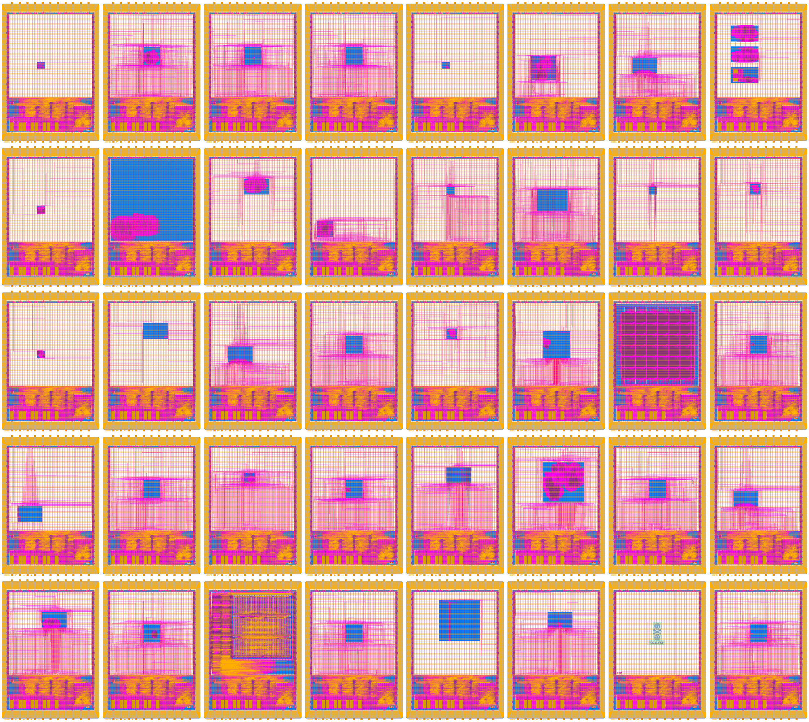

# Google / Efabless GF180MCU Open MPW shuttle GFMPW-0

GFMPW-0 was the first GlobalFoundries GF180MCU shuttle of the Google-sponsored Open MPW program, run by Efabless; the final dies were committed in December 2022. Every project is a [Caravel](https://github.com/efabless/caravel-gf180mcu) die: the user design in `user_project_wrapper` (about 3.0 × 3.0 mm), surrounded by the same management SoC, housekeeping SPI, padframe and power routing on every die.

- Shuttle ID: GFMPW-0
- Process: GF180MCU
- Number of slots: 40 (40x 1×1, as an 8 × 5 grid)

<table width="100%">
  <tr>
  <td width="50%"></td>
  <td width="50%"></td>
  </tr>
</table>

This repository presents the shuttle in the same format as the [wafer.space](https://wafer.space/) run repositories ([ws-run1](https://github.com/wafer-space/ws-run1), [ws-run2](https://github.com/wafer-space/ws-run2)), so the same tools can analyse it. The "reticle" in `layout/` is synthetic: it was assembled from the individual final dies published at [https://foss-eda-tools.googlesource.com/third_party/shuttle/gf180mcu/mpw-000](https://foss-eda-tools.googlesource.com/third_party/shuttle/gf180mcu/mpw-000), placed in wafer.space 1×1 slot positions. It is not the mask set as manufactured. The dies keep their arrangement on the real GFMPW-0 reticle, as shown in Efabless's `images/gfmpw-0-original.png`, where each die lies on its side in 8 rows of 5. Here, and in `images/gfmpw-0.png` above, the whole reticle is turned 90° clockwise so that its long edge is at the top and every die is upright: position A1 is at the top right, A8 at the top left and E1 at the bottom right.

In the layout, every cell of a die is renamed `<CODE>_<original name>` and each die's top cell is `<CODE>_caravel_<column>_<row>`. The code is the last four hex digits of the Efabless user ID.

# Public Projects

| Code | Project | Slot Size | Project Details | Repository | Efabless ID | Efabless name | Position |
|---|---|---|---|---|---|---|---|
| 0ABD | VGA Clock for GF180 | 1x1 | Fork of Matt Venn's VGA clock for GF180MCU, by Russell L Friesenhahn. | https://github.com/russellfriesenhahn/gf180-russell | 18000abd | gf180_russell | B1 (slot-002) |
| 0AFF | PDM driver and dice | 1x1 | PDM driver and dice module with 7 segment display. By Harry Snell. | https://github.com/H-S-S-11/gf180-mpw0 | 18000aff | pdm_and_dice_gf180-mpw0 | E1 (slot-005) |
| 105A | AS2650 | 1x1 | Avalon Semiconductors AS2650: partial implementation of the Signetics 2650 8-bit CPU architecture from 1975. | https://github.com/AvalonSemiconductors/AS2650 | 1800105a | as2650 | B6 (slot-027) |
| 14FB | SkullFET | 1x1 | SkullFET barebone transistor cells (inverter, NAND). By Uri Shaked. | https://github.com/wokwi/gf180_skullfet | 180014fb | skullfet_gf180 | E2 (slot-010) |
| 1E9A | HyperRAM controller | 1x1 | Wishbone connected HyperRAM controller. | https://github.com/embelon/gf180-wb-hyperram | 18001e9a | hyperram_controller | D6 (slot-029) |
| 1F37 | Beep Boop Traffic Light Controller | 1x1 | Sequencer for a traffic light with a walk button, with timings tuned to match the iconic 'beep boop' streetlight formerly installed in front of Carnegie Mellon University. By Anish Singhani. | https://foss-eda-tools.googlesource.com/third_party/shuttle/gf180mcu/mpw-000/slot-003 | 18001f37 | tiny_user_project_beepboop | C1 (slot-003) |
| 4515 | Tiny user project: inverter | 1x1 | TinyTapeout-style inverter test design. | https://foss-eda-tools.googlesource.com/third_party/shuttle/gf180mcu/mpw-000/slot-012 | 18004515 | tiny_user_project_inverter | B3 (slot-012) |
| 45D6 | Ophelia eFPGA | 1x1 | Open-source Uranus eFPGA fabric with 112 4-input LUTs, configured over the Caravel Wishbone bus. | https://foss-eda-tools.googlesource.com/third_party/shuttle/gf180mcu/mpw-000/slot-030 | 180045d6 | ophelia_efpga | E6 (slot-030) |
| 472A | ChipFlow example SoC with 3.3V cells | 1x1 | ChipFlow example SoC placed and routed with the 3.3V version of the c4m-flexcell standard cells. | https://foss-eda-tools.googlesource.com/third_party/shuttle/gf180mcu/mpw-000/slot-028 | 1800472a | chipflow_example_soc_with_3v3_cells | C6 (slot-028) |
| 4F9E | MCU for solar power | 1x1 | Starter MCU with an integrated MPPT for solar applications such as microinverters. | https://foss-eda-tools.googlesource.com/third_party/shuttle/gf180mcu/mpw-000/slot-017 | 18004f9e | mcu_solar | B4 (slot-017) |
| 56C6 | One-hot FABulous FPGA | 1x1 | FABulous FPGA test on GF180 with a custom one-hot SRAM and transmission gate element for routing. | https://github.com/gatecat/one_hot_fpga_gf180 | 180056c6 | onehot_fabulous_fpga_on_gf180 | C2 (slot-008) |
| 58D2 | TestFlipFlops | 1x1 | Test design for testing flip-flops, designed in Wokwi. By Alexander Shabarshin. | https://github.com/shaos/tiny_silicon_1 | 180058d2 | test1 | E5 (slot-025) |
| 5F3A | Clock divider | 1x1 | Clock divider by 2 to 1024, to test the GF180 technology at CINVESTAV Guadalajara. | https://foss-eda-tools.googlesource.com/third_party/shuttle/gf180mcu/mpw-000/slot-036 | 18005f3a | divider | A8 (slot-036) |
| 5FF2 | 74181 ALU | 1x1 | TinyTapeout-style 74181 ALU. By Thorsten Knoll. | https://foss-eda-tools.googlesource.com/third_party/shuttle/gf180mcu/mpw-000/slot-023 | 18005ff2 | tiny_user_project_74181_alu | C5 (slot-023) |
| 6079 | Serv tri-core (GF180 MPW0 Serv) | 1x1 | SERV RISC-V CPUs with a scan chain around the Wishbone bus. By Greg Davill. | https://github.com/gregdavill/gf180-mpw0-serv | 18006079 | serv-tri-core | A1 (slot-001) |
| 6106 | FiveGuys | 1x1 | Five 4-bit up-counters. | https://github.com/AyaseErii/gf180-FiveGuys | 18006106 | gf180-fiveguys | E4 (slot-020) |
| 66AD | ALU (paper) | 1x1 | ALU test supporting the article 'Fast Tape-Out Process of an Embedded System-on-Chip with Vector Instruction Accelerator'. CINVESTAV. | https://foss-eda-tools.googlesource.com/third_party/shuttle/gf180mcu/mpw-000/slot-022 | 180066ad | alu_paper_gf180 | B5 (slot-022) |
| 679D | Rift2Fake | 1x1 | Test design: an LFSR16 whose output shows four random hex digits on 7-segment displays. | https://github.com/whutddk/Rift2Fake_gf180_mpw0 | 1800679d | rift2fake_test_gf180_mpw0 | E3 (slot-015) |
| 6E0D | Synchronous modulator | 1x1 | Synchronous modulator, part of a PhD project at CINVESTAV Guadalajara. | https://foss-eda-tools.googlesource.com/third_party/shuttle/gf180mcu/mpw-000/slot-037 | 18006e0d | modulador | B8 (slot-037) |
| 6F7B | Game of Life cell | 1x1 | Conway's Game of Life cell, designed in Wokwi. By Uri Shaked. | https://github.com/urish/gf180-game-of-life-cell | 18006f7b | game_of_life_cell | D2 (slot-009) |
| 7F0C | Universal gates | 1x1 | Universal gates: any 2-input Boolean function built from at most 5 NAND gates. By Tamas Hubai. | https://foss-eda-tools.googlesource.com/third_party/shuttle/gf180mcu/mpw-000/slot-019 | 18007f0c | unigate-gf | D4 (slot-019) |
| 8455 | GF180 state machine | 1x1 |  | https://github.com/goEricBi/gf180_state_machine | 18008455 | gf180_state_machine | D8 (slot-039) |
| 8BB5 | PWM / Wishbone core | 1x1 | Eight synchronised 8-bit programmable PWMs controlled by a Wishbone slave interface. | https://github.com/james-tandon-csueb/gf180-pwm | 18008bb5 | gf180_pulse_width_modulator | E8 (slot-040) |
| 8D82 | XLS bit population count | 1x1 | TinyTapeout design counting the bits set in the input, generated with the XLS high-level synthesis toolkit. | https://foss-eda-tools.googlesource.com/third_party/shuttle/gf180mcu/mpw-000/slot-034 | 18008d82 | lfsr | D7 (slot-034) |
| 9C7C | GreenRio (GF version) | 1x1 | GreenRio core from RIOS Lab. | https://foss-eda-tools.googlesource.com/third_party/shuttle/gf180mcu/mpw-000/slot-018 | 18009c7c | greenrio_gf_version | C4 (slot-018) |
| 9DDB | Asynchronous modulator | 1x1 | Asynchronous modulator, part of a PhD project at CINVESTAV Guadalajara. | https://foss-eda-tools.googlesource.com/third_party/shuttle/gf180mcu/mpw-000/slot-038 | 18009ddb | modulador_a | C8 (slot-038) |
| A006 | 5-bit multiplier | 1x1 | Custom 5-bit multiplier, similar to a Wallace or Dadda multiplier. | https://github.com/Gior-gio/5bitsMulti-gf180 | 1800a006 | 5bitsmulti-gf180 | C7 (slot-033) |
| A3A3 | Signed 8-bit multiplier | 1x1 | Signed 8-bit multiplier, alongside the VGA clock demo. | https://github.com/mcmorgul/gf180-multiplier-8-seq | 1800a3a3 | signed_8-bit_multiplier | B2 (slot-007) |
| B22E | TestAsyncTrimux | 1x1 | Test circuit for a 3-rail asynchronous ternary selector, designed in Wokwi. By Alexander Shabarshin. | https://github.com/shaos/tiny_silicon_2 | 1800b22e | testasynctrimux | A6 (slot-026) |
| B676 | SPELL for GF180 | 1x1 | SPELL, a minimalist stack-based programming language from The Skull CTF, implemented in Verilog (verispell). | https://github.com/wokwi/gf180_spell | 1800b676 | spell | A3 (slot-011) |
| BBE0 | posoco2000 | 1x1 | Drives a 7-segment display to show the word posoco2000. | https://github.com/urielcho/posoco2000_gf180 | 1800bbe0 | posoco2000_gf180 | A4 (slot-016) |
| C301 | 8x8 Bit Pattern Player | 1x1 | 8x8 bit serial programmable, addressable and playable memory. By Thorsten Knoll. | https://foss-eda-tools.googlesource.com/third_party/shuttle/gf180mcu/mpw-000/slot-024 | 1800c301 | tiny_user_project_8x8_player | D5 (slot-024) |
| C979 | VerilogBoy | 1x1 | GameBoy-compatible system (SM83 CPU core, pixel processing unit) from the VerilogBoy project. | https://foss-eda-tools.googlesource.com/third_party/shuttle/gf180mcu/mpw-000/slot-014 | 1800c979 | verilogboy | D3 (slot-014) |
| E91D | EduRISC16 | 1x1 | A 16-bit RISC themed processor for educational purposes. By Ryan Price. | https://foss-eda-tools.googlesource.com/third_party/shuttle/gf180mcu/mpw-000/slot-013 | 1800e91d | edurisc16 | C3 (slot-013) |
| EAD1 | Reversible programmable logic IC | 1x1 | Quad 3-input Fredkin gate which can be programmed into the three basic logic gates (AND, OR, NOT) whose outputs are reversible. | https://foss-eda-tools.googlesource.com/third_party/shuttle/gf180mcu/mpw-000/slot-021 | 1800ead1 | reversible_programmable_logic_ic | A5 (slot-021) |
| EB3D | Jacaranda-8 8-bit CPU | 1x1 | CHARLATAN, a simple implementation of the Jacaranda-8 educational ISA for home-built CPU beginners. | https://github.com/cpu-dev/caravel_jacaranda-8_GF180 | 1800eb3d | caravel_jacaranda-8_gf180 | A2 (slot-006) |
| F0DD | Pyramiden Core (RV16U) | 1x1 | 16-bit RISC-V microcore processor with 21-bit instructions and 16 registers. By David Richie (Brown Deer Technology). | https://foss-eda-tools.googlesource.com/third_party/shuttle/gf180mcu/mpw-000/slot-031 | 1800f0dd | pyramiden_core | A7 (slot-031) |
| F330 | 16 x 4-bit dual port register file | 1x1 | A dual port register file plus an XNOR test gate. By Rolf Widenfelt. | https://github.com/rolfmobile99/tiny_user_project | 1800f330 | 16x4_bit_dual_port_register_file | E7 (slot-035) |
| F4D8 | OpenFASoC test structures in GF180MCU | 1x1 | OpenFASoC test structures. | https://github.com/AL-255/OpenFASOC_GF180_teststructures | 1800f4d8 | openfasoc_test_structures_in_gf180mcu | D1 (slot-004) |
| FF8E | Hash accelerator with clock multiplexing | 1x1 |  | https://foss-eda-tools.googlesource.com/third_party/shuttle/gf180mcu/mpw-000/slot-032 | 1800ff8e | hash_accelerator_with_clock_multiplexing | B7 (slot-032) |

# View the Reticle Layout

1. To view the reticle layout, please install [KLayout](https://www.klayout.de/).
2. Next, assemble `GFMPW0.oas` from the individual files: `cd layout; ./create-reticle-oas.sh`
3. The assembled `GFMPW0.oas` file can then be opened with KLayout.
4. Finally, load the layer properties file in KLayout: "File → Load Layer Properties" and choose `lyp/gf180mcu.lyp`.

Note: The `GFMPW0.oas` file was split with `split -b 90M GFMPW0.oas GFMPW0-part-`

# Provenance

- Source: the shuttle mirrors at [https://foss-eda-tools.googlesource.com/third_party/shuttle/gf180mcu/mpw-000](https://foss-eda-tools.googlesource.com/third_party/shuttle/gf180mcu/mpw-000): one repository per slot (`slot-001` ... `slot-040`) plus `foundry`, which holds `manifest-gfmpw-0.csv`, `gfmpw-0.png` (kept here unchanged as `images/gfmpw-0-original.png`; the copy shown above is turned 90° clockwise) and the DRC summary.
- Each die is `tapeout/outputs/oas/caravel_<ID>.oas` at the head of `main` in its slot repository. 34 of the 40 match the SHA1 in `manifest-gfmpw-0.csv`. The other six (slots 002, 008, 019, 020, 021 and 029) were updated by Efabless on 2022-12-30 and 2023-01-03 to remove the PR boundary layer (0/0) and the outline shape, the same change the `foundry` repository records as "remove pr boundary for projects"; the manifest SHA1s still refer to the earlier versions. This repository uses the later files.
- None of the 40 dies contain PR boundary (0/0) shapes, including inside the standard cells.
- Repository links point to the designer's GitHub repository where one in a public mirror contains the slot's three newest non-Efabless commits; otherwise to the slot repository at googlesource.
- 39 slot repositories are Apache-2.0 licensed; slot-019 (unigate-gf) is MIT licensed.

# License

The projects shown here are public. Each project's slot repository at googlesource contains its licence; for information on licences, please refer to the individual repositories.
