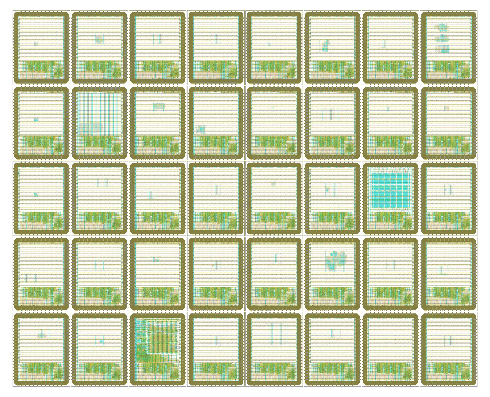

# Google / Efabless GFMPW-0

[Google](https://opensource.google/) & [Efabless](https://efabless.com/) GF180MCU Open MPW Shuttle GFMPW-0

- Shuttle ID: GFMPW0
- Process: GF180MCU
- Number of slots: 40

<table width="100%">
  <tr>
  <td width="50%"></td>
  <td width="50%"></td>
  </tr>
</table>

This shuttle was not run by wafer.space. See [PROVENANCE.md](PROVENANCE.md) for where the layouts come from and how this repository was generated.

# Public Projects

| Code | Project | Slot Size | Project Details | Repository |
|---|---|---|---|---|
| 0ABD | VGA Clock for GF180 | 1x1 | Fork of Matt Venn's VGA clock for GF180MCU, by Russell L Friesenhahn. | https://github.com/russellfriesenhahn/gf180-russell |
| 0AFF | PDM driver and dice | 1x1 | PDM driver and dice module with 7 segment display. By Harry Snell. | https://github.com/H-S-S-11/gf180-mpw0 |
| 105A | AS2650 | 1x1 | Avalon Semiconductors AS2650: partial implementation of the Signetics 2650 8-bit CPU architecture from 1975. | https://github.com/AvalonSemiconductors/AS2650 |
| 14FB | SkullFET | 1x1 | SkullFET barebone transistor cells (inverter, NAND). By Uri Shaked. | https://github.com/wokwi/gf180_skullfet |
| 1E9A | HyperRAM controller | 1x1 | Wishbone connected HyperRAM controller. | https://github.com/embelon/gf180-wb-hyperram |
| 1F37 | Beep Boop Traffic Light Controller | 1x1 | Sequencer for a traffic light with a walk button, with timings tuned to match the iconic 'beep boop' streetlight formerly installed in front of Carnegie Mellon University. By Anish Singhani. | https://foss-eda-tools.googlesource.com/third_party/shuttle/gf180mcu/mpw-000/slot-003 |
| 4515 | Tiny user project: inverter | 1x1 | TinyTapeout-style inverter test design. | https://foss-eda-tools.googlesource.com/third_party/shuttle/gf180mcu/mpw-000/slot-012 |
| 45D6 | Ophelia eFPGA | 1x1 | Open-source Uranus eFPGA fabric with 112 4-input LUTs, configured over the Caravel Wishbone bus. | https://foss-eda-tools.googlesource.com/third_party/shuttle/gf180mcu/mpw-000/slot-030 |
| 472A | ChipFlow example SoC with 3.3V cells | 1x1 | ChipFlow example SoC placed and routed with the 3.3V version of the c4m-flexcell standard cells. | https://foss-eda-tools.googlesource.com/third_party/shuttle/gf180mcu/mpw-000/slot-028 |
| 4F9E | MCU for solar power | 1x1 | Starter MCU with an integrated MPPT for solar applications such as microinverters. | https://foss-eda-tools.googlesource.com/third_party/shuttle/gf180mcu/mpw-000/slot-017 |
| 56C6 | One-hot FABulous FPGA | 1x1 | FABulous FPGA test on GF180 with a custom one-hot SRAM and transmission gate element for routing. | https://github.com/gatecat/one_hot_fpga_gf180 |
| 58D2 | TestFlipFlops | 1x1 | Test design for testing flip-flops, designed in Wokwi. By Alexander Shabarshin. | https://github.com/shaos/tiny_silicon_1 |
| 5F3A | Clock divider | 1x1 | Clock divider by 2 to 1024, to test the GF180 technology at CINVESTAV Guadalajara. | https://foss-eda-tools.googlesource.com/third_party/shuttle/gf180mcu/mpw-000/slot-036 |
| 5FF2 | 74181 ALU | 1x1 | TinyTapeout-style 74181 ALU. By Thorsten Knoll. | https://foss-eda-tools.googlesource.com/third_party/shuttle/gf180mcu/mpw-000/slot-023 |
| 6079 | Serv tri-core (GF180 MPW0 Serv) | 1x1 | SERV RISC-V CPUs with a scan chain around the Wishbone bus. By Greg Davill. | https://github.com/gregdavill/gf180-mpw0-serv |
| 6106 | FiveGuys | 1x1 | Five 4-bit up-counters. | https://github.com/AyaseErii/gf180-FiveGuys |
| 66AD | ALU (paper) | 1x1 | ALU test supporting the article 'Fast Tape-Out Process of an Embedded System-on-Chip with Vector Instruction Accelerator'. CINVESTAV. | https://foss-eda-tools.googlesource.com/third_party/shuttle/gf180mcu/mpw-000/slot-022 |
| 679D | Rift2Fake | 1x1 | Test design: an LFSR16 whose output shows four random hex digits on 7-segment displays. | https://github.com/whutddk/Rift2Fake_gf180_mpw0 |
| 6E0D | Synchronous modulator | 1x1 | Synchronous modulator, part of a PhD project at CINVESTAV Guadalajara. | https://foss-eda-tools.googlesource.com/third_party/shuttle/gf180mcu/mpw-000/slot-037 |
| 6F7B | Game of Life cell | 1x1 | Conway's Game of Life cell, designed in Wokwi. By Uri Shaked. | https://github.com/urish/gf180-game-of-life-cell |
| 7F0C | Universal gates | 1x1 | Universal gates: any 2-input Boolean function built from at most 5 NAND gates. By Tamas Hubai. | https://foss-eda-tools.googlesource.com/third_party/shuttle/gf180mcu/mpw-000/slot-019 |
| 8455 | GF180 state machine | 1x1 |  | https://github.com/goEricBi/gf180_state_machine |
| 8BB5 | PWM / Wishbone core | 1x1 | Eight synchronised 8-bit programmable PWMs controlled by a Wishbone slave interface. | https://github.com/james-tandon-csueb/gf180-pwm |
| 8D82 | XLS bit population count | 1x1 | TinyTapeout design counting the bits set in the input, generated with the XLS high-level synthesis toolkit. | https://foss-eda-tools.googlesource.com/third_party/shuttle/gf180mcu/mpw-000/slot-034 |
| 9C7C | GreenRio (GF version) | 1x1 | GreenRio core from RIOS Lab. | https://foss-eda-tools.googlesource.com/third_party/shuttle/gf180mcu/mpw-000/slot-018 |
| 9DDB | Asynchronous modulator | 1x1 | Asynchronous modulator, part of a PhD project at CINVESTAV Guadalajara. | https://foss-eda-tools.googlesource.com/third_party/shuttle/gf180mcu/mpw-000/slot-038 |
| A006 | 5-bit multiplier | 1x1 | Custom 5-bit multiplier, similar to a Wallace or Dadda multiplier. | https://github.com/Gior-gio/5bitsMulti-gf180 |
| A3A3 | Signed 8-bit multiplier | 1x1 | Signed 8-bit multiplier, alongside the VGA clock demo. | https://github.com/mcmorgul/gf180-multiplier-8-seq |
| B22E | TestAsyncTrimux | 1x1 | Test circuit for a 3-rail asynchronous ternary selector, designed in Wokwi. By Alexander Shabarshin. | https://github.com/shaos/tiny_silicon_2 |
| B676 | SPELL for GF180 | 1x1 | SPELL, a minimalist stack-based programming language from The Skull CTF, implemented in Verilog (verispell). | https://github.com/wokwi/gf180_spell |
| BBE0 | posoco2000 | 1x1 | Drives a 7-segment display to show the word posoco2000. | https://github.com/urielcho/posoco2000_gf180 |
| C301 | 8x8 Bit Pattern Player | 1x1 | 8x8 bit serial programmable, addressable and playable memory. By Thorsten Knoll. | https://foss-eda-tools.googlesource.com/third_party/shuttle/gf180mcu/mpw-000/slot-024 |
| C979 | VerilogBoy | 1x1 | GameBoy-compatible system (SM83 CPU core, pixel processing unit) from the VerilogBoy project. | https://foss-eda-tools.googlesource.com/third_party/shuttle/gf180mcu/mpw-000/slot-014 |
| E91D | EduRISC16 | 1x1 | A 16-bit RISC themed processor for educational purposes. By Ryan Price. | https://foss-eda-tools.googlesource.com/third_party/shuttle/gf180mcu/mpw-000/slot-013 |
| EAD1 | Reversible programmable logic IC | 1x1 | Quad 3-input Fredkin gate which can be programmed into the three basic logic gates (AND, OR, NOT) whose outputs are reversible. | https://foss-eda-tools.googlesource.com/third_party/shuttle/gf180mcu/mpw-000/slot-021 |
| EB3D | Jacaranda-8 8-bit CPU | 1x1 | CHARLATAN, a simple implementation of the Jacaranda-8 educational ISA for home-built CPU beginners. | https://github.com/cpu-dev/caravel_jacaranda-8_GF180 |
| F0DD | Pyramiden Core (RV16U) | 1x1 | 16-bit RISC-V microcore processor with 21-bit instructions and 16 registers. By David Richie (Brown Deer Technology). | https://foss-eda-tools.googlesource.com/third_party/shuttle/gf180mcu/mpw-000/slot-031 |
| F330 | 16 x 4-bit dual port register file | 1x1 | A dual port register file plus an XNOR test gate. By Rolf Widenfelt. | https://github.com/rolfmobile99/tiny_user_project |
| F4D8 | OpenFASoC test structures in GF180MCU | 1x1 | OpenFASoC test structures. | https://github.com/AL-255/OpenFASOC_GF180_teststructures |
| FF8E | Hash accelerator with clock multiplexing | 1x1 |  | https://foss-eda-tools.googlesource.com/third_party/shuttle/gf180mcu/mpw-000/slot-032 |

# View the Reticle Layout

1. To view the reticle layout, please install [KLayout](https://www.klayout.de/).
2. Next, assemble `GFMPW0.oas` from the individual files: `cd layout; cat GFMPW0-part-?? >GFMPW0.oas`
3. The assembled `GFMPW0.oas` file can then be opened with KLayout.
4. Finally, load the layer properties file in KLayout: "File → Load Layer Properties" and choose `lyp/gf180mcu.lyp`.

Note: The `GFMPW0.oas` file was split with `split -b 90M GFMPW0.oas GFMPW0-part-`

# License

The projects shown here are public. For information on licences, please refer to the individual repositories.
